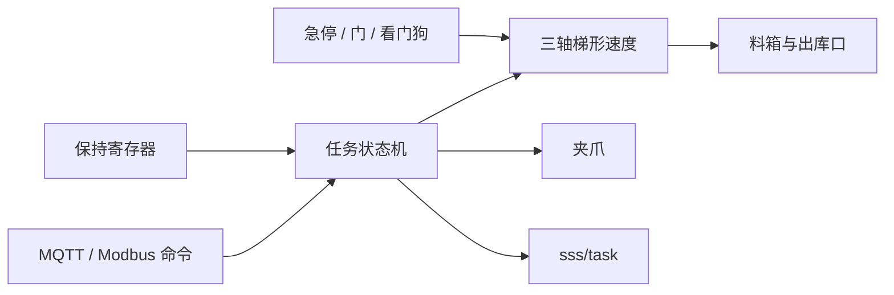

# YooMi Cell

立体库里的一个料箱单元控制器。直角坐标三轴、夹爪、安全联锁、Modbus RTU，以及 YooMi 前端已经在订阅的 MQTT 主题 `sss/task`。

控制算法和任务状态机是可移植的 C11，不依赖具体芯片。当前仓库用同一套代码在 Linux 上做软件在环仿真，`make test` 会跑完出库、入库、暂停、急停、空抓、看门狗和 Modbus 帧。换到板上时，只替换 1 ms 节拍和引脚，见 [docs/porting.md](docs/porting.md)。

## 和前端的关系

前端任务列表和底栏订阅 `sss/task`，只用这四个字段：

| 字段 | 含义 |
| --- | --- |
| `groupId` | 任务组 |
| `taskNumber` | 已完成步数，前端把它写成 `taskFinishTotal` |
| `groupState` | `RUN`、`PAUSE`、`FINISH` |
| `poolInfo` | 底栏那一行字，例如「前往库位 A3」 |

控制器在每一步开始时发布一条，例如：

```json
{"groupId":"G1001","taskNumber":5,"groupState":"RUN","poolInfo":"前往库位 A3"}
```

下发走 `sss/cell/cmd`，状态走 `sss/cell/status`。寄存器表和库位坐标在 [docs/protocol.md](docs/protocol.md)。

## 一个节拍里发生什么



1 kHz 调用 `cell_tick`。运动规划用微米和微米/秒的整数，不在控制回路里分配内存。

料箱是 4 列 × 6 行。出库：回零、到库位、下降、夹取、抬到安全高度、送到出库口、松开。入库是这条路径反过来。

## 编译

需要 CMake 和 GCC 或 Clang。

```sh
make test
make demo
```

`make test` 编完并跑全部断言。`make demo` 仿真一次 A3 出库再入库，标准输出就是前端会收到的那些 JSON。正常结束时最后一行是 `RESULT ok`。

## 目录

```
include/yoomi/     对外头文件
src/               运动、夹爪、安全、Modbus、MQTT 帧、任务
ports/esp32/       ESP32-S3 上的 1 ms 任务入口
tests/             主机测试
docs/              协议和移植
```

## 目标板

逻辑已经按这两块主流板留了接缝，引脚和任务划分写在移植说明里：

- ESP32-S3-DevKitC-1：Wi-Fi 上跑 MQTT，UART 做 Modbus RTU
- STM32F407：TIM6 产生 1 kHz，USART 做 Modbus，步进脉冲走定时器
